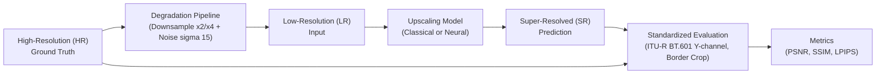

# Model Architecture & Benchmark Design

This document details the super-resolution pipeline, the supported classical and neural architectures, the design of the custom `OurNN` model, and its systematic ablation study.

---

## 1. End-to-End Benchmark Pipeline

The benchmark evaluates how accurately different methods restore high-frequency image details lost during downsampling and noise corruption.



### Evaluation Protocol
To align with published super-resolution literature:
1. **Color Space**: Both SR and HR images are converted to luminance (Y-channel in ITU-R BT.601).
2. **Quantization**: Clamped to [0, 255] and quantized to 8-bit unsigned integers.
3. **Border Cropping**: Edges are cropped by `scale` pixels to discard boundary padding artifacts.
4. **Metrics**:
   * **PSNR** (Peak Signal-to-Noise Ratio, higher is better, logarithmic dB scale).
   * **SSIM** (Structural Similarity Index, higher is better, bounded between 0 and 1).
   * **LPIPS** (Learned Perceptual Image Patch Similarity, lower is better, optional).

---

## 2. Supported Models

### Classical Baselines
Implemented in [`src/models/classical.py`](file:///home/ultra/code/github/Image-processing-Interpolation-using-neural-networks/src/models/classical.py):
* **Nearest Neighbor**: Zero-order hold, fastest but highly pixelated.
* **Bilinear**: First-order linear interpolation between neighboring pixels.
* **Bicubic**: Standard 2D cubic spline interpolation (Catmull-Rom), commonly used as the reference baseline.
* **Lanczos**: Sinc-based filter with high sharpness, effective at preserving fine repetitive patterns.

### Comparative Neural Networks
* **SRCNN** ([`src/models/srcnn.py`](file:///home/ultra/code/github/Image-processing-Interpolation-using-neural-networks/src/models/srcnn.py)): The foundational 3-layer CNN (Dong et al., 2014) operating on pre-upscaled bicubic inputs (9x9 -> 1x1 -> 5x5 convolutions).
* **ESPCN** ([`src/models/espcn.py`](file:///home/ultra/code/github/Image-processing-Interpolation-using-neural-networks/src/models/espcn.py)): Efficient Sub-Pixel Convolutional Network (Shi et al., 2016) extracting features directly in low-resolution space and reconstructing HR via a sub-pixel pixel-shuffle layer.
* **EDSR-Lite** ([`src/models/edsr_lite.py`](file:///home/ultra/code/github/Image-processing-Interpolation-using-neural-networks/src/models/edsr_lite.py)): A lightweight adaptation of Enhanced Deep Super-Resolution (Lim et al., 2017) using residual blocks without Batch Normalization.

---

## 3. OurNN Custom Architecture

`OurNN` ([`src/models/our_nn.py`](file:///home/ultra/code/github/Image-processing-Interpolation-using-neural-networks/src/models/our_nn.py)) is a modular, lightweight super-resolution neural network designed to achieve high PSNR/SSIM while maintaining low parameter count and inference latency.

### Architecture Diagram

```text
LR Input (B, 3, H, W)
  │
  ├─────────────────────────────────────────┐ (if bicubic_skip=True)
  │                                         │
  ▼                                         │
[Head Conv 3x3] (B, n_feats, H, W)          │
  │                                         │
  ├───────── (if edge_branch=True) ──────┐  │
  │                                      │  │
  │     [Luminance Gray Map] (B, 1, H, W)│  │
  │             │                        │  │
  │     [Fixed Sobel-X, Y, Laplacian]    │  │
  │             │                        │  │
  │     [Concat Edge Maps] (B, 3, H, W)  │  │
  │             │                        │  │
  │     [Edge Conv 3x3 + ReLU]           │  │
  │             │ (B, n_feats, H, W)     │  │
  │             ▼                        │  │
  └─────► [Concat & 1x1 Fuse Conv]       │  │
                │ (B, n_feats, H, W)     │  │
                ▼                        │  │
        [N Residual Blocks + SE Attn]    │  │
                │                        │  │
        [Body Conv 3x3]                  │  │
                │ + Global Residual      │  │
                ▼                        │  │
        [Sub-Pixel Upsampler Conv]       │  │
                │ (B, n_feats, s*H, s*W) │  │
                ▼                        │  │
        [Tail Conv 3x3]                  │  │
                │                        │
                ▼                        ▼
        Residual (B, 3, s*H, s*W)  +  Bicubic Upscale (B, 3, s*H, s*W)
                │                        │
                └───────────┬────────────┘
                            ▼
                  SR Output (B, 3, s*H, s*W)
```

### Architectural Key Innovations

1. **Fixed Edge-Prior Branch (`edge_branch`)**:
   Computes horizontal/vertical Sobel gradients and discrete 2D Laplacian edge maps on luminance directly using frozen convolutional filters. These structural priors are fused into the main feature trunk, guiding the network on sharp transitions without adding trainable weights.
2. **Residual Backbone with Squeeze-and-Excitation (`attention`)**:
   Stacks N residual blocks without batch normalization. Each block includes a channel attention module (Squeeze-and-Excitation) that models interdependencies among feature channels.
3. **Sub-Pixel Upsampling**:
   All core feature extraction occurs at low resolution (H, W), keeping computational cost low. Features are expanded to high resolution (scale*H, scale*W) via pixel-shuffle only at the tail.
4. **Global Bicubic Skip Connection (`bicubic_skip`)**:
   The network learns only the high-frequency residual difference between the bicubic baseline and the ground truth. Zero-initializing the tail convolution ensures the model starts from the bicubic baseline at training step 0 and smoothly improves.

### Parameters & Configuration Flags

| Parameter | Default | Description |
|---|---|---|
| `scale` | *Required* | Upscaling factor (2, 3, or 4). |
| `n_feats` | `32` | Intermediate feature channels throughout trunk. |
| `n_blocks` | `6` | Number of residual blocks in the deep body. |
| `res_scale` | `0.1` | Residual scaling multiplier for training stability. |
| `reduction` | `4` | Channel reduction ratio for Channel Attention. |
| `bicubic_skip` | `True` | Adds global bicubic upscaled LR to output. |
| `attention` | `True` | Enables Squeeze-and-Excitation attention in resblocks. |
| `edge_branch` | `True` | Extracts and fuses fixed Sobel/Laplacian edge priors. |
| `zero_init_tail`| `True` | Initializes tail weights/bias to 0 for residual learning. |

---

## 4. Ablation Study Plan

To quantify the contribution of each design element, `OurNN` is evaluated across 4 systematic ablation steps on both clean and noise-corrupted (sigma=15) data:

| Ablation Step | Config File | `bicubic_skip` | `attention` | `edge_branch` | Question Answered |
|---|---|---|---|---|---|
| **a0 (Plain)** | `configs/our_nn_x4_clean_a0_plain.yaml` | `False` | `False` | `False` | Baseline capability of plain deep CNN. |
| **a1 (+Skip)** | `configs/our_nn_x4_clean_a1_skip.yaml` | `True` | `False` | `False` | Impact of learning residual over bicubic base. |
| **a2 (+Attn)** | `configs/our_nn_x4_clean_a2_attn.yaml` | `True` | `True` | `False` | Impact of Squeeze-and-Excitation attention. |
| **Full Model** | `configs/our_nn_x4_clean.yaml` | `True` | `True` | `True` | Value of edge-prior fusion branch. |

---

## 5. Adding a New Architecture

To add a new model to the benchmark suite:

1. Create your model module in `src/models/your_model.py`:
   ```python
   import torch.nn as nn
   from src.models.registry import MODELS

   @MODELS.register("your_model")
   class YourModel(nn.Module):
       def __init__(self, scale: int = 4, n_feats: int = 64, **kwargs):
           super().__init__()
           # Architecture definition...

       def forward(self, x):
           # Forward pass...
           return x
   ```
2. The model is automatically discovered by `src/models/__init__.py` (no manual import edits required).
3. Create an experiment configuration YAML inheriting from `configs/_base_x4.yaml`:
   ```yaml
   _base_: _base_x4.yaml
   experiment:
     name: your_model_x4_clean

   model:
     name: your_model
     label: "YourModel (x4)"
     params:
       n_feats: 64
   ```
4. Run training via `python scripts/train.py --config configs/your_model_x4_clean.yaml`. The new model is automatically discovered by the web UI and analysis notebooks.
